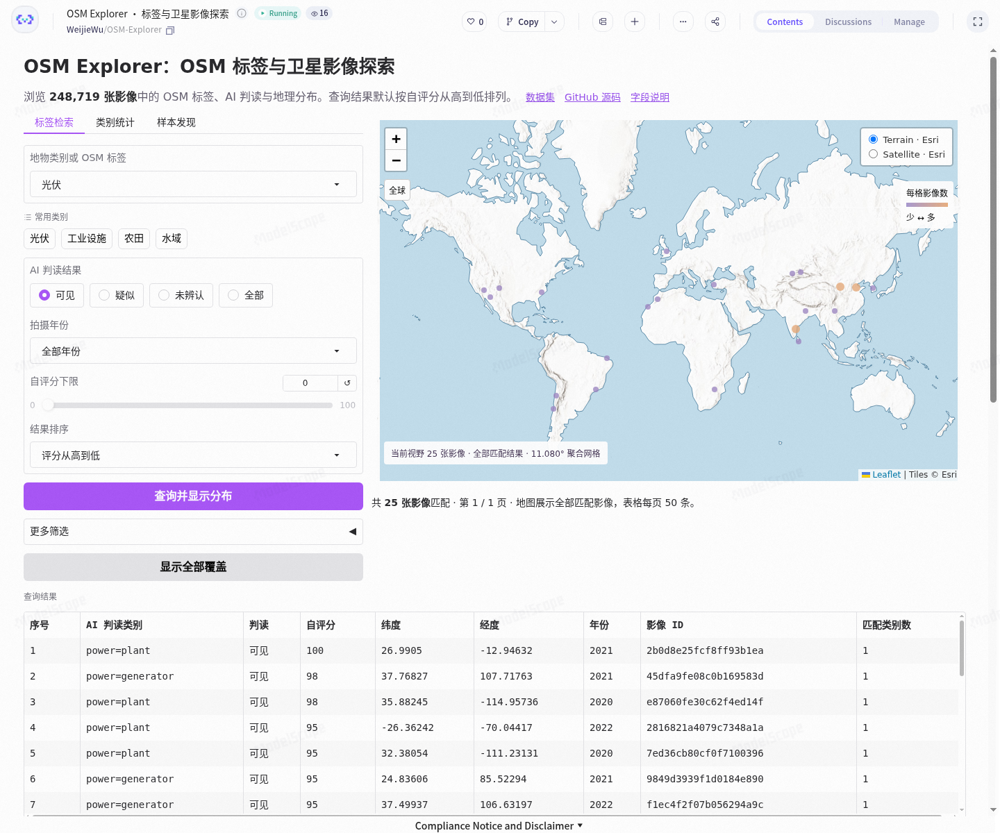

# OSM Explorer

基于 [EEE Benchmark AI 可见性筛选第二版](https://modelscope.cn/datasets/WeijieWu/EEE-benchmark-OSM-249K-AI-Filtered-v2) 的全球 OSM 标签、卫星影像与 AI 判读探索工具。

[在线创空间](https://modelscope.cn/studios/WeijieWu/OSM-Explorer) · [GitHub](https://github.com/go-bananas-wwj/OSM-Explorer)



## 使用

左侧选择光伏、工业设施等主题，或输入原始类别、`key=value` 标签。选择 AI 判读、年份和分数下限后点击查询。结果默认按 **自评分降序**，同分按影像 ID 保持稳定顺序。

- 右侧地图显示**全部匹配影像**的空间聚合，与表格分页独立。缩放查看更细的网格，点击单个样本查看原图。
- 下方表格每张影像只出现一次；同图多个候选匹配时，以最高分的匹配候选代表该图，并显示匹配类别数。
- 点击结果行或地图样本，查看原始 RGB、AI 判读理由、证据方位、别解、OSM 标签和影像来源。
- 左图显示整图及原始 OSM mask，右图按选中对象局部放大；可切换对象或关闭填色。mask 直接读取数据集的 `masks_npz`，通过 `mask_index` 对齐对象；放大保留原始像元，用最近邻显示，青色框标出裁剪范围。
- 预览区展示当前排序的前 10 张影像；总结果少于 10 张时整块隐藏。预览排名与表格分页独立。
- 全局统计独立成页，默认显示 v2 可见类别的 AI 判读条数、图内 OSM 对象关联条数、去重影像数及占全库比例，支持切换判读范围、类别搜索、排序和 CSV 导出。点选类别可直接进入精确类别的地图结果。
- 样本发现按组展示真实影像：类别丰富按整图可见类别数排序；稀有类别在全库仅覆盖 1–50 张可见影像；疑似与别解保留模型的其他解释。打开样本时保留所选候选类别，详情中的整图判读表也可点击切换类别。
- 可按国家代码或当前地图范围过滤，翻页，导出全部匹配结果为 CSV。

### 主题与评分

`ai_visible` 是对 `ai_verdict` 所选结论的自评分，**不是可见概率**。例如高分“未辨认”不会进入“可见”结果。默认分数下限为 0，保留全部可见判读并按分数排序。

工业设施主题匹配 `landuse=industrial`、`building=industrial`、`man_made=works` 等原始标签；其 AI 判读可能是“建成区”或“建筑”，界面保留该真实类别。

部分光伏/风电的 `generator:source` 等属性没有直接的 AI candidate_id。索引仅在**同一个 OSM 对象**同时具有能源属性和已判读的 `power=generator/plant` 标签时建立关联。`context_tags_json` 记录这些属性，原始 AI 类别、理由和分数保持不变。光伏主题中 `power=plant` 的“可见”仍然是整图电站类别的弱判读，不被改写为“模型确认了光伏板”。

地图统计的是本数据集收录的影像数，不是全球设施总数或对象密度。国家过滤来自原始 OSM 行政区标签；未带国家代码的样本仍保留在全球结果中。

## 全局统计口径

统计始终以全库 **248,719 张影像**为百分比分母，不受地图、年份或检索页分数条件影响。类别列表的关键字只筛选类别名称，不改变分母。

- AI 判读条数来自 v2 `ai_feature_reviews`；每张图每类一条，所以本版中同类判读条数等于覆盖影像数。
- `osm_object_rows` 根据 v2 原始 `ai_tag_reviews` 键值关联有几何的 `osm_annotations`，按图像、候选、`object_key` 去重。一个对象的多个匹配标签不会重复计数；跨图可重复，不包含仅上下文父关系。
- 对象关联计数不是 AI 的逐对象可见性确认。同图可有多类，各类影像占比不要求合计 100%。
- 应用的“光伏”等主题与原始 v2 类别分开展示，类别统计及统计页跳转使用原始类别精确匹配。

完整来源核对结果见 [`reports/global-statistics-validation.json`](reports/global-statistics-validation.json)：全部 555,542 条 v2 原始判读的类别、结论、评分、理由、证据方位和别解均未改动。

## 数据与性能

固定数据版本和所有索引文件哈希见 `data/manifest.json`。全量原始数据为 491 个分片、248,719 张唯一影像；构建时逐文件验证 SHA-256 与总行数。发布索引只包含查询需要的元数据和判读；原始影像、对象几何按需从固定源版本的 Parquet 中读取。不会下载整个遥感影像数据集。

采用 DuckDB + Parquet，只读查询、全结果地图空间聚合、分页列表、按需 RGB 缓存。无需 GPU 或额外模型 API。

RGB 采用 B04/B03/B02 联合有效像元、共享 2–98 百分位拉伸及 1/1.8 gamma，与数据集的 AI 输入配色方法一致。源影像首次读取需访问 ModelScope，失败时显示重试提示，查询结果保留。

## 本地运行

```bash
python -m venv .venv
source .venv/bin/activate
pip install -r requirements.txt
python app.py
```

监听 `0.0.0.0:7860`。`PORT` 可更改端口；`OSM_CACHE_DIR` 可设置缓存目录。

### 重建索引

从数据集获取 `release_manifest.json` 到 `work/`，然后：

```bash
python scripts/build_index.py --workers 10
python scripts/enrich_themes.py
python scripts/build_global_counts.py
python -m pytest -q
```

支持逐分片断点续建。`work/` 中的原始分片、临时状态和凭据均不进入版本库。

## 部署到 ModelScope

使用官方 [创空间文档](https://modelscope.cn/docs/studios/intro) 与 [OpenAPI](https://modelscope.cn/.well-known/openapi.json)：

1. 创建 Gradio 创空间，版本 `5.49.1`，免费 CPU `platform/2v-cpu-8g-mem`，基础环境 `ubuntu22.04-py310-torch2.3.1-modelscope1.21.0`。
2. 在创空间的独立 Git 工作副本中同步源码，使用 Git LFS 跟踪 `data/*.parquet` 后推送 `master`。ModelScope 限制普通 Git 单文件不超过 10 MiB；GitHub 仓库保留直接可读的索引文件，两端使用相同的数据 SHA-256。不要将 GitHub 的普通大文件提交历史直接推入创空间。
3. 调用 `POST /openapi/v1/studios/{owner}/{repo_name}/deploy` 或在平台点击部署。
4. 检查构建/运行日志和 `/healthz`；应显示 `complete: true`、`images: 248719`。

应用运行只访问公开数据，不需要把 GitHub 或 ModelScope 管理 token 放入源码、前端或创空间变量。创空间使用 `.lfsconfig` 在构建克隆时跳过索引下载；`bootstrap.py` 在启动时通过公开的 ModelScope LFS 接口获取固定 SHA-256 的索引，并校验大小和哈希后缓存。普通 GitHub 克隆已有完整文件，不触发下载。

## 来源与许可

- 本项目代码：Apache-2.0。
- 原始 OSM 数据及派生标签数据库：© OpenStreetMap contributors，ODbL 1.0。`data/` 的数据库内容不因代码许可而改用 Apache。
- 影像：Copernicus Sentinel-2 / Major-TOM，沿用源数据 CC BY-SA 4.0。运行时 RGB 预览沿用源许可。
- AI 判读：来自用户发布的第二版数据集，保留其来源、固定版本与弱标签语义。
- 界面布局参考 [EarthEmbeddingExplorer](https://modelscope.cn/studios/Major-TOM/EarthEmbeddingExplorer-Dense-Qwen3-VL-Embedding)。Leaflet 为 BSD-2-Clause，Natural Earth 海岸线为 public domain；详见 `NOTICE` 和 `static/LEAFLET-LICENSE`。
